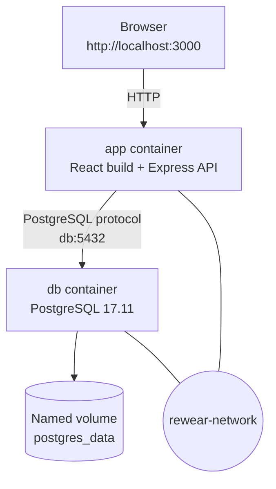

# ReWear Campus

A simple campus marketplace for preloved fashion items. Students can browse second-hand products and publish a new listing. This project is built as a multi-tier web application using React, Express, PostgreSQL, Docker, and Docker Compose.

> **Project status:** Educational MVP for the Cloud Computing / Docker Compose assignment. It is not a production e-commerce platform and does not process payments.

## 1. Project Background

Many students own clothes, bags, and accessories that are still usable but are no longer worn. At the same time, other students look for affordable fashion items. ReWear Campus provides a simple place for students to give those items a second life.

I chose this project because I am interested in sustainable fashion and want to develop my skills toward a **Full-Stack Developer** career. The project lets me work with a frontend interface, REST API, relational database, containerization, and local deployment.

## 2. MVP Features

- Browse the product catalogue.
- Filter products by category.
- Add a product listing with name, category, price, condition, seller name, and description.
- Store and retrieve product records from PostgreSQL.
- Check application and database connectivity through `GET /health`.

The MVP intentionally excludes payment processing, user authentication, chat, and checkout to keep the assignment focused on containerization.

## 3. Technology Stack

| Layer | Technology | Responsibility |
|---|---|---|
| Frontend | React, TypeScript, Vite | User interface and product form |
| Backend | Node.js, Express 5 | REST API and static frontend hosting in production |
| Database | PostgreSQL 17.11 | Persistent product data |
| Container | Docker | Build and run the application image |
| Orchestration | Docker Compose | Connect application, database, network, and volume |
| Optional database UI | Adminer | Inspect the local database using the `tools` profile |

## 4. Project Structure

```text
rewear-campus/
├── client/
│   ├── index.html
│   └── src/
│       ├── App.tsx
│       ├── main.tsx
│       └── styles.css
├── server/
│   └── index.js
├── docs/screenshots/
├── .dockerignore
├── .env.example
├── .gitignore
├── Dockerfile
├── docker-compose.yml
├── package.json
├── tsconfig.json
└── vite.config.js
```

`package-lock.json` is generated by `npm install` and should be committed after installation. The local `.env` file is intentionally excluded from Git.

## 5. Architecture

The React application is built into static files. In the production container, Express serves those files and exposes the API. PostgreSQL runs in a separate container. The two services communicate through the user-defined Docker network `rewear-network`; the application connects to the database using the Compose service name `db`, not an IP address or `localhost`.



### Local ports

| Host address | Container service | Purpose |
|---|---|---|
| `http://localhost:3000` | `app:3000` | ReWear Campus web application |
| `localhost:5433` | `db:5432` | Optional PostgreSQL access from the host |
| `http://localhost:8080` | `adminer:8080` | Optional database UI, only when the `tools` profile is enabled |

Inside the Docker network, the app uses `db:5432`. `localhost` inside the app container would refer to the app container itself, not PostgreSQL.

## 6. API Endpoints

| Method | Endpoint | Description | Success status |
|---|---|---|---|
| `GET` | `/health` | Checks the app and database connection | `200 OK` |
| `GET` | `/api/products` | Returns the product list | `200 OK` |
| `POST` | `/api/products` | Inserts a product into PostgreSQL | `201 Created` |

Example request body for `POST /api/products`:

```json
{
  "name": "Vintage Denim Jacket",
  "category": "Outerwear",
  "description": "A pre-loved denim jacket in good condition.",
  "price": 85000,
  "condition": "Good",
  "sellerName": "Febryan"
}
```

Allowed `condition` values are `Like New`, `Good`, and `Fair`. The backend validates input and uses parameterized SQL queries.

## 7. Requirements

- Git
- Docker Desktop with Docker Compose
- Node.js 26 LTS and npm (only needed when running the development server outside the app container)
- A code editor such as Visual Studio Code

## 8. Run with Docker Compose

1. Clone the repository:

   ```bash
   git clone https://github.com/USERNAME/rewear-campus.git
   cd rewear-campus
   ```

2. Create local environment file:

   **Windows PowerShell:**

   ```powershell
   Copy-Item .env.example .env
   ```

   **macOS / Linux / Git Bash:**

   ```bash
   cp .env.example .env
   ```

3. Open `.env` and change `POSTGRES_PASSWORD` to a local development password.
4. Build and start the application:

   ```bash
   docker compose up -d --build
   ```

5. Open [http://localhost:3000](http://localhost:3000).

Check service status and logs:

```bash
docker compose ps
docker compose logs -f app
```

The `db` service should show `healthy`. The `app` service should show `healthy` after its health check succeeds.

## 9. Run the Optional Adminer Tool

Adminer is not started by default. Start it only when needed:

```bash
docker compose --profile tools up -d
```

Open [http://localhost:8080](http://localhost:8080) and use:

- System: PostgreSQL
- Server: `db`
- Username: the value of `POSTGRES_USER` in `.env`
- Password: the value of `POSTGRES_PASSWORD` in `.env`
- Database: the value of `POSTGRES_DB` in `.env`

Stop the stack with:

```bash
docker compose down
```

## 10. Test the API

### Health check

```bash
curl -i http://localhost:3000/health
```

Expected status: `200 OK`.

### Read products

```bash
curl -i http://localhost:3000/api/products
```

Expected status: `200 OK` and a JSON array.

### Create a product

**Windows PowerShell:**

```powershell
$body = @{
  name = "Canvas Tote Bag"
  category = "Tas"
  description = "A reusable second-hand tote bag."
  price = 35000
  condition = "Like New"
  sellerName = "Febryan"
} | ConvertTo-Json

Invoke-WebRequest -Uri http://localhost:3000/api/products -Method POST -ContentType "application/json" -Body $body
```

**macOS / Linux / Git Bash:**

```bash
curl -i -X POST http://localhost:3000/api/products \
  -H "Content-Type: application/json" \
  -d '{"name":"Canvas Tote Bag","category":"Tas","description":"A reusable second-hand tote bag.","price":35000,"condition":"Like New","sellerName":"Febryan"}'
```

Expected status: `201 Created`. Refresh the website or call `GET /api/products` to see the inserted record.

## 11. Test Database Persistence

1. Add a new product through the form or `POST /api/products`.
2. Confirm it appears in `GET /api/products`.
3. Stop and remove the containers without deleting volumes:

   ```bash
   docker compose down
   ```

4. Start the stack again:

   ```bash
   docker compose up -d
   ```

5. Call `GET /api/products` again. The product should still exist because PostgreSQL stores its data in the named volume `postgres_data`.

**Important:** `docker compose down -v` also removes the named volume. That deletes the persisted local database data. Use it only when you intentionally want to reset the database.

## 12. Run the Frontend and Backend in Development Mode (Optional)

The full assignment runtime is Docker Compose. For faster code iteration, you can run PostgreSQL in Docker and the React/Vite and Express development servers on your computer.

1. Copy `.env.example` to `.env` and keep `DB_HOST=127.0.0.1` and `DB_PORT=5433` for host-based development.
2. Start only PostgreSQL:

   ```bash
   docker compose up -d db
   ```

3. Install Node dependencies:

   ```bash
   npm install
   npm run typecheck
   ```

   `npm install` creates `package-lock.json`; commit that file to GitHub after it is generated.

4. Start the Vite frontend and Express backend:

   ```bash
   npm run dev
   ```

5. Open [http://localhost:5173](http://localhost:5173).

Vite proxies `/api` and `/health` requests to Express on port `4000`. In the Docker Compose production run, Express serves the compiled frontend on port `3000`.

## 13. Docker Image and Multi-stage Build

The `Dockerfile` has two stages:

- **builder:** installs all dependencies and runs `npm run build` to create the React production files.
- **runtime:** installs production dependencies only, copies the Express server and compiled frontend, and runs as the non-root `node` user.

The runtime stage does not copy Vite, React development tooling, or the source files needed only for the build. This reduces the final runtime image compared with shipping the full development environment.

After building, record the actual size on your computer:

```bash
docker images rewear-campus
```

The Dockerfile uses `COPY` because it copies local files and directories predictably. `ADD` has extra behavior, such as automatically extracting local tar archives and supporting remote URLs, which is unnecessary for this project.
